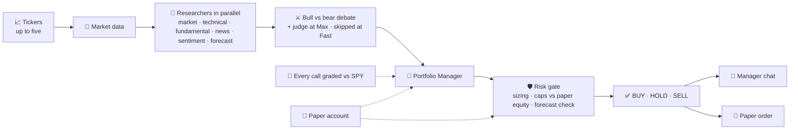

<div align="center">


**Real-time, multi-agent AI stock research and paper trading, powered by CrewAI.**

[](https://www.python.org/)
[](https://fastapi.tiangolo.com/)
[](https://www.crewai.com/)
[](https://docs.astral.sh/uv/)
[](#disclaimer)

[Highlights](#highlights) · [Quick start](#quick-start) · [Using the app](#using-the-app) · [Configuration](#configuration) · [API](#api) · [Backtesting](#-backtesting-results) · [Wiki](https://github.com/kingabzpro/BetterTradingAgents/wiki)

</div>

---

Six analysts research each ticker in parallel (market regime, technicals, fundamentals,
news, sentiment, forecast), a bull/bear debate with a neutral judge sharpens the case,
and a risk-gated **BUY / HOLD / SELL** call comes back with sizing and the full
reasoning trail. Every call is later graded against what the market actually did.
Paper trading only. Research base: the
[TradingAgents framework](https://arxiv.org/abs/2412.20138); the
[wiki](https://github.com/kingabzpro/BetterTradingAgents/wiki) carries the details.


## Highlights

| | Feature | What it means |
|:---:|---|---|
| ⚡ | **Parallel by design** | Researchers, data fetches, and tickers run concurrently. |
| 🌍 | **Market regime** | A dedicated analyst reads S&P 500, Nasdaq, VIX, and the 10-year yield. |
| ⚔️ | **Real debate** | Bull vs bear, then a neutral judge cross-examines both at Max depth. |
| 🗣️ | **Social sentiment** | Reads Reddit and StockTwits; flags thin crowds as noise. |
| ⚖️ | **Risk-gated decisions** | Volatility-scaled sizing capped by per-ticker, invested, and cash limits. |
| 📜 | **Learns from its calls** | Every decision graded on return and alpha vs SPY; lessons feed the next run. |
| 💬 | **Chat with the manager** | Follow-up chat grounded in that run's research. |
| 🕶️ | **Incognito mode** | Market-only run: no account, no saving; download the report and it is gone. |
| 🧪 | **Walk-forward backtests** | Replay past dates with point-in-time data, graded vs SPY after costs. |
| 🕘 | **Durable history** | Every run saved in SQLite, reopenable from the Runs page. |
| 📊 | **Real market data** | Finnhub, Olostep, yfinance; TimeGPT or Chronos-2 forecasts, local fallback. |
| 🧠 | **Model flexibility** | Any OpenAI-compatible LLM, split by role. |
| 🛡️ | **Autopilot with guard rails** | Scheduled paper sessions through the same risk gate and caps. |
| 🪶 | **No frontend build step** | Vanilla HTML, CSS, and JavaScript served by FastAPI. |

## How it works



## Quick start

You need [Python 3.12+](https://www.python.org/) and [uv](https://docs.astral.sh/uv/).

```bash
git clone https://github.com/kingabzpro/BetterTradingAgents.git
cd BetterTradingAgents
uv sync        # install dependencies
uv run setup   # interactive wizard: pick a provider, paste keys, done
uv run app     # start the app on http://127.0.0.1:8000
```

> [!TIP]
> No LLM key yet? Leave `LLM_API_KEY` empty and the full workflow runs in clearly
> labeled mock mode on live market data. Everything is editable later on the in-app
> Settings page, no restart needed.

## Using the app

| Screen | What it does |
|---|---|
| **Home** | Analyze up to 5 tickers with outlook and depth, or let **I Am Feeling Lucky** screen candidates. **Incognito** runs market-only and saves nothing. |
| **History** | Every run saved with a direct `?run=<id>` link; rerun or cancel from the live view. |
| **Trades** | Paper account: equity curve, positions, order lifecycle, return vs SPY, reconciliation drift banner, and the **Autopilot** card for scheduled sessions (notifications optional). |
| **Settings** | Every knob editable live; keys go to the OS keychain. The experimentation switch adds opt-in retired pages. |

Screen-by-screen walkthrough with screenshots: wiki [Usage](https://github.com/kingabzpro/BetterTradingAgents/wiki/Usage).

## Configuration

Everything is editable in the app (Settings page); `.env` is the default layer. Key
sign-up links and what is optional: wiki [Providers](https://github.com/kingabzpro/BetterTradingAgents/wiki/Providers).

| Variable | Default | Purpose |
|---|---|---|
| `LLM_BASE_URL` | `https://api.openai.com/v1` | OpenAI-compatible endpoint |
| `LLM_API_KEY` | Not set | Enables the LLM agents; without it, mock mode |
| `LLM_MODEL` | `gpt-5.6-luna` | Model for every role without an override |
| `FINNHUB_API_KEY` | Not set | Fundamentals and news (yfinance fallback) |
| `OLOSTEP_API_KEY` | Not set | News search and social sentiment |
| `NIXTLA_API_KEY` | Not set | 5-day forecast (TimeGPT) |
| `TSFM_API_KEY` | Not set | 5-day forecast (Chronos-2) when TimeGPT is down |
| `ALPACA_API_KEY_ID` | Not set | Alpaca **paper** key; enables paper trading |
| `ALPACA_TRADING_ENABLED` | `0` | Kill switch for order submissions |
| `AUTOMATION_*` | see `.env.example` | Autopilot schedule, candidates, confidence bar |

Everything else (per-role models, cost overrides, risk caps, memory, backtest knobs):
wiki [Configuration](https://github.com/kingabzpro/BetterTradingAgents/wiki/Configuration).

## Security

- Keys live in the OS keychain ([keyring](https://pypi.org/project/keyring/)), never in the database or logs.
- Binds to `127.0.0.1` only; rejects non-loopback `Host` and cross-site `Origin` headers.
- Paper only: the Alpaca client hardcodes `paper=True`; no live-trading path exists.

## API

| Method | Route | Purpose |
|:---:|---|---|
| `POST` | `/api/analyze` | Start an analysis run |
| `GET` | `/api/runs/{run_id}` | Run status and results |
| `GET` | `/api/runs/{run_id}/events` | Live progress over SSE |
| `POST` | `/api/runs/{run_id}/chat` | Follow-up chat with the manager |
| `GET/POST` | `/api/settings` | Read and save settings (secrets masked) |
| `GET` | `/api/broker/account` | Paper account state |
| `POST` | `/api/broker/orders` | Place one paper order (explicit `confirm`) |
| `GET` | `/api/broker/sync` | Reconciliation and drift state |
| `POST` | `/api/automation/run` | Fire one autopilot session |
| `GET` | `/api/health` | Configuration and provider status |

Full schema and SSE catalog: wiki [API](https://github.com/kingabzpro/BetterTradingAgents/wiki/API).

## 📈 Backtesting Results

We tested BetterTradingAgents using **walk-forward backtesting**, replaying historical trading decisions against SPY after transaction costs. Each replay uses only information available at the time, with an untouched holdout for evaluation.

<div align="center">

### 🏆 Max Configuration Leads the Backtest


**6 Tickers • 23 Dates • 138 Decisions per Configuration**

</div>

### Performance Comparison

| Configuration | Cumulative Return | Mean Alpha |
|:---|---:|---:|
| Fast (3 agents) | 🔴 **-9.19%** | -0.71% |
| SPY (buy & hold, same window) | ⚪ +12.41% | - |
| Pro (7 agents) | 🟢 **+45.04%** | +0.37% |
| **🏆 Max (10 agents + judge)** | **🟢 +94.87%** | **+1.80%** |

### Key Findings

- 🚀 **+214.6% cumulative return** for Max in the full grid, compared with **+132.2%** for a momentum baseline and **+31.3%** for SPY.
- 📊 **+1.28% net per decision** for Max over Fast in the paired evaluation, with a 95% confidence interval excluding zero.
- 🛡️ **24.5% vs 44.6% worst drawdown** with the judge included versus removed.
- 🧪 **Reproducible evaluation** with point-in-time data, holdout splits, bootstrap intervals, and run manifests.

### Run the Backtest

```bash
# Replay historical trading decisions
uv run python -m app.backtest --tickers NVDA,AMD,META --start 2026-03-01 --end 2026-06-30 --step 21

# Reproduce the optimization sweep
uv run python scripts/backtest_sweep.py
```

> **Note:** The reported replays use free deterministic mock agents rather than live LLM-generated decisions. Real-LLM backtesting requires explicit cost approval. Historical simulated performance does not guarantee live trading returns.

**Detailed Reports:** [Optimization Sweep](https://github.com/kingabzpro/BetterTradingAgents/blob/main/backtests/report-sweep.md) · [Paired Evaluation](https://github.com/kingabzpro/BetterTradingAgents/blob/main/backtests/report-paired-depth.md) · [Backtesting Guide](https://github.com/kingabzpro/BetterTradingAgents/wiki/Backtesting)

## Development

```bash
uv run test         # fast offline suite
uv run test all     # every group, including the browser smoke test
```

Check catalog: wiki [Testing](https://github.com/kingabzpro/BetterTradingAgents/wiki/Testing);
module walkthrough: [Architecture](https://github.com/kingabzpro/BetterTradingAgents/wiki/Architecture).

## Roadmap

The plan, shipped status, and research anchors live in the wiki's
[Roadmap](https://github.com/kingabzpro/BetterTradingAgents/wiki/Roadmap) page.

## Disclaimer

> [!WARNING]
> BetterTradingAgents is an educational project, not investment advice. The portfolio is simulated;
> nothing in this project executes real trades.

An improved and streamlined implementation inspired by
[TradingAgents](https://github.com/TauricResearch/TradingAgents). Licensed under
[MIT](LICENSE).
